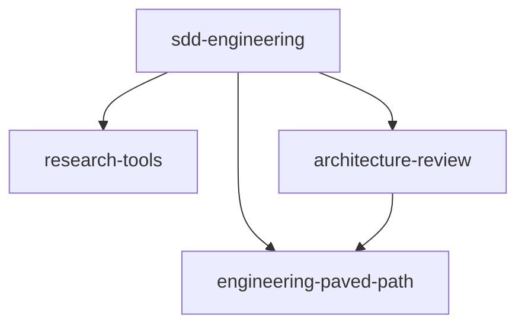

# dev-digest-ai-marketplace

A Claude Code plugin marketplace with the team AI harness extracted from DevDigest: a
spec-driven development workflow and the shared plugins it depends on. It lives apart
from the DevDigest product so the harness and the product keep separate owners and
release cadences.

**Catalog:** https://anastasiiaaandriienko.github.io/dev-digest-ai-marketplace/ — search
plugins, skills and agents, read their docs, see dependencies and copy install commands.

## Plugins

| Plugin | Version | What it gives you | Depends on |
|---|---|---|---|
| [`sdd-engineering`](plugins/sdd-engineering/README.md) | 1.0.0 | `/run-plan`: spec → plan → implement → review → verify with approval gates; `/workflow-retro`; `engineering-insights` | the three below |
| [`architecture-review`](plugins/architecture-review/README.md) | 1.0.0 | read-only `architecture-reviewer` agent driven by your repository's architecture docs | `engineering-paved-path` |
| [`research-tools`](plugins/research-tools/README.md) | 1.0.0 | read-only `researcher` agent with file:line and URL evidence | — |
| [`engineering-paved-path`](plugins/engineering-paved-path/README.md) | 1.0.0 | shared skills: onion architecture, Fastify, Drizzle, PostgreSQL, Zod | — |

## Dependency graph



```
sdd-engineering@1.0.0
├── engineering-paved-path@^1.0.0
├── research-tools@^1.0.0
└── architecture-review@^1.0.0
    └── engineering-paved-path@^1.0.0
```

Dependencies point one way only: `sdd-engineering` consumes the other three, and
`architecture-review` consumes `engineering-paved-path`. Components of other plugins
are referenced by namespaced name (`research-tools:researcher`,
`architecture-review:architecture-reviewer`, `engineering-paved-path:zod`).

## Usage

Requires Claude Code `>= 2.1.110` (version-constrained dependencies).

```sh
# once per machine or project
claude plugin marketplace add anastasiiaaandriienko/dev-digest-ai-marketplace --scope project
# install a plugin; its dependencies are installed with it
claude plugin install sdd-engineering@dev-digest-ai-marketplace --scope project
# check that everything resolved
claude plugin list --json
```

Inside a session the same works with `/plugin marketplace add …` and
`/plugin install …`; run `/reload-plugins` or start a new session afterwards.

### Updating

```sh
claude plugin marketplace update dev-digest-ai-marketplace
claude plugin update sdd-engineering@dev-digest-ai-marketplace --scope project
```

### Stable channel and rollback

`channels/stable/` is a second marketplace, `dev-digest-ai-marketplace-stable`. Every
plugin in it is pinned to a verified release tag and commit, so it keeps serving that
version after `main` moves on. To roll back, uninstall the plugin from the latest
channel and install it from stable:

```sh
claude plugin uninstall sdd-engineering@dev-digest-ai-marketplace --scope project --keep-data --prune -y
claude plugin marketplace add https://raw.githubusercontent.com/anastasiiaaandriienko/dev-digest-ai-marketplace/main/channels/stable/.claude-plugin/marketplace.json --scope project
claude plugin install sdd-engineering@dev-digest-ai-marketplace-stable --scope project
```

Release, update and rollback rules, and the rollback rehearsal script, are in
[docs/RELEASES.md](docs/RELEASES.md).

## Repository layout

```
.claude-plugin/marketplace.json   catalog: plugin names, sources, catalog metadata
plugins/<name>/                   one directory per plugin
  .claude-plugin/plugin.json      the plugin's source of truth: name, version, dependencies
  agents/  skills/  evals/        components and behavior evals
  README.md  CHANGELOG.md         required for every plugin
channels/stable/                  stable channel: the same plugins pinned to release tags and commits
docs/                             guidelines, security, releases, cost baseline, catalog site spec
scripts/validate-marketplace.mjs  structure and content lint (complements `claude plugin validate`)
scripts/rehearse-rollback.mjs     latest → stable → latest rehearsal in a throwaway config (no model calls)
scripts/build-index.mjs           catalog data: index.json, releases.json, stats.json, Markdown bodies
scripts/test/                     tests for the lint and the index builder
site/                             catalog site (React + TypeScript + Vite), see docs/SITE-SPEC.md
.github/workflows/validate.yml    CI: lint, tests, `claude plugin validate`, catalog build
.github/workflows/pages.yml       builds the catalog from main and deploys it to GitHub Pages
```

## Contributing

See [CONTRIBUTING.md](CONTRIBUTING.md) and
[docs/PLUGIN-GUIDELINES.md](docs/PLUGIN-GUIDELINES.md). Checks before a pull request:

```sh
npm run validate        # structure and content lint, no dependencies
npm test                # tests for the lint and the index builder
claude plugin validate .
cd site && npm ci && npm test && npm run build   # catalog site
```

## License

MIT, see [LICENSE](LICENSE). Bundled third-party skills keep their own MIT licenses;
see [plugins/engineering-paved-path/THIRD_PARTY_NOTICES.md](plugins/engineering-paved-path/THIRD_PARTY_NOTICES.md).
